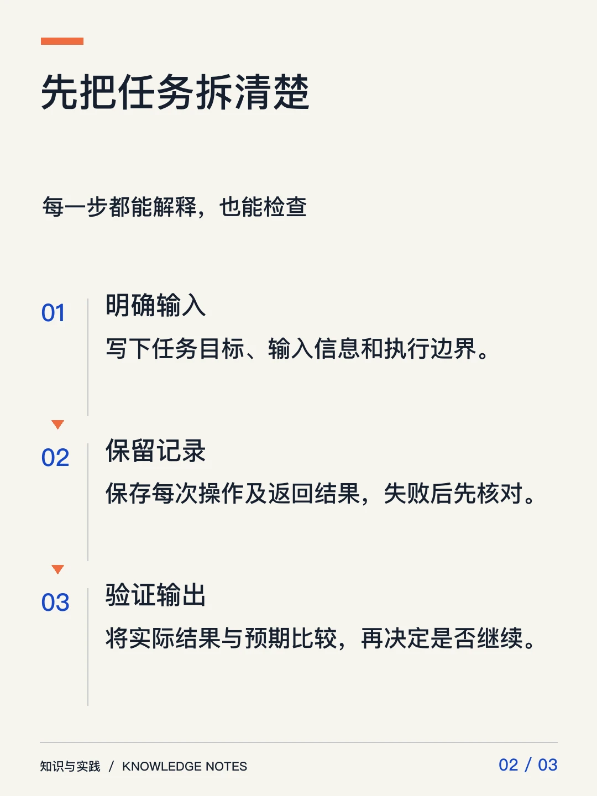
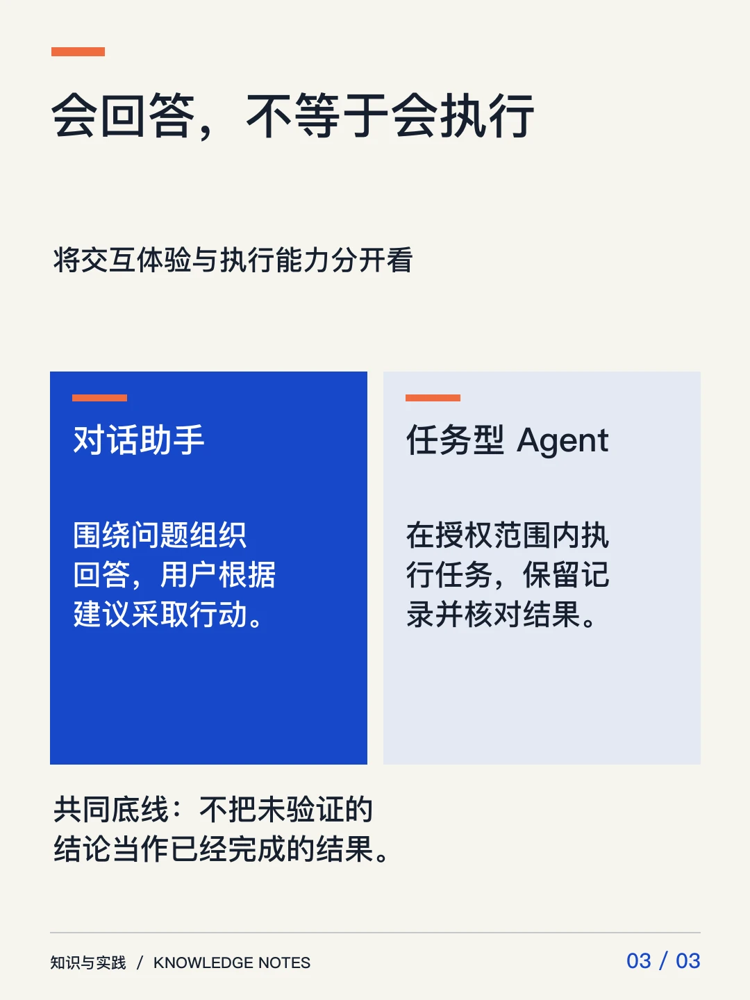

<p align="center">
  
</p>

# 营运智能体

营运智能体是一款给创作者、店主和运营团队用的中文桌面应用。告诉它你想写什么、写给谁，它就能围绕主题找资料、拟选题，准备一篇带配图的草稿。默认由你审稿、系统按账号时段排期，发布后它还会核对平台上的结果。

**当前为 macOS 开发预览版，界面为简体中文。** 网页自动发布主要面向小红书。你也可以先写稿、整理资料，等需要发布或处理互动时再登录平台账号。Windows x64 正在验证中。

[准备第一篇稿件](#第一次使用) · [完整使用指南](docs/user-guide.md) · [从源码运行](#本地运行服务端和桌面端)

## 它能帮你做什么

**把零散资料变成下一篇选题。** 例如，你经营一家社区咖啡店，想给刚开始手冲的客人写一篇选豆指南。可以让它按关键词收集资料，到「资料」查看原文和出处，把值得反复参考的内容留下。经营多个品牌或栏目时，可以为每个主题分别保存资料、稿件和计划。

**把选题做成可以审阅的图文。** AI 根据已有资料写正文，还能把步骤、要点和对比整理成一组配图。你可以改标题、重写一段话、替换封面，也可以从空白文档自己写，草稿会自动保存。生成杂志组图需要配置生图和视觉分析模型。

| 图文样张 · 封面 | 流程内页 | 对比内页 |
| --- | --- | --- |
|  |  |  |

**定好时间，发布后也能查到结果。** 默认先审稿，再安排发布。排期后可以查看时间或取消预约，修改稿件后需要重新审核。想看看发布进行到哪一步，可以打开「运营画面」。首页出现「结果待核对」时，系统会在调度和桌面执行器可用时自动回到网页核对，无需为了确认结果再发一遍。

**把需要你回复的消息集中起来。** 在「互动 → 消息处理」里一起看评论、私信和关注通知。你可以只开启接收，自己决定怎么回，也可以单独授权自动回复，需要时接手某条消息。回到首页能看到哪些消息还需要你处理，以及当天完成了哪些工作。

## 第一次使用

如果已经拿到 macOS 测试安装包，打开应用后，可以先用一个小主题试做第一篇稿件。

1. **连接模型。** 打开「设置 → 模型」，添加你使用的 AI 服务并选择模型。
2. **写下主题和读者。** 在「首页 → 快速开始」选择场景，填入具体目标。例如：“给第一次买手冲豆的客人写一篇选购指南，介绍浅烘和深烘的口味差别。”工作方式选「准备内容」。
3. **开始准备。** 在「业务与主题」打开运营计划，确认启用的功能和每日数量，点击「开始运营」。如果还想补资料，可以先选「保存，稍后开始」。
4. **打开第一篇稿件。** 到「内容 → 待审核」检查标题、正文、来源和配图。有了可用资料，也可以在这里点「生成图文」。满意后，如果想发布，到「账号」登录平台，确认发布权限，设置账号的每日发布时段，再对稿件点击「审核通过」，系统自动排期。

## 日常使用

| 你可能关心 | 在应用里怎么做 |
| --- | --- |
| 到了发布时间，需要开着电脑吗？ | 让 Mac 保持唤醒，桌面应用和后台保持运行，平台账号保持登录。遇到登录验证时，可以接管网页，处理后继续。 |
| 每篇都要自己审核吗？ | 新主题默认人工审核。你可以在任务设置中让之后生成的 AI 新稿通过自动检查后排期，或按评分分流。手写稿仍由你审核。 |
| 能控制 AI 费用吗？ | 模型、搜索和生图按你选择的服务计费。可以为主题设置每日模型调用次数或 Token 用量，也可以设置多个主题共用的模型预算。 |
| 草稿和经营数据存在哪里？ | 资料、草稿和执行记录主要保存在本机。调用外部服务时，相应输入会发给该服务。导入经营表格时，可以限定哪些汇总数据或脱敏字段允许 AI 读取。 |
| 团队能安排其他工作吗？ | 在「看板」分配任务、设置依赖、查看进度。每个看板默认手动管理，需要时可单独开启自动执行。 |

[日常操作与常见问题](docs/user-guide.md) · [手动写稿与草稿保存](docs/writing-editor.md) · [配图效果与配置](docs/visual-generation.md)

## 开发与许可

[本地运行与 macOS 打包](docs/desktop-development.md) · [Windows 开发与测试包](docs/windows-development.md) · [功能与运行参考](docs/operations-reference.md) · [代码地图](docs/code-map.md) · [贡献指南](CONTRIBUTING.md)

### 本地运行服务端和桌面端

<details>
<summary>展开 macOS 双终端启动命令</summary>

需要 macOS、Git 和 Xcode Command Line Tools。打开两个终端，均在仓库根目录执行，并使用相同的独立开发数据目录。

**终端一：启动服务端（Gateway）。每次启动或重启前，先执行停止命令，等待成功退出后再启动。**

```bash
export HERMES_HOME="$HOME/hermes-operations-dev"
export HERMES_RUNTIME_DIR="$HERMES_HOME/tools"
source ./activate
./.hermes/bin/hermes gateway stop
./.hermes/bin/hermes gateway run -v
```

**终端二：启动桌面端。保持终端一的服务端运行。**

```bash
export HERMES_HOME="$HOME/hermes-operations-dev"
export HERMES_RUNTIME_DIR="$HERMES_HOME/tools"
source ./activate
npm ci # 首次运行或依赖变化时执行
HERMES_DESKTOP_HERMES_ROOT="$PWD" npm run dev --workspace apps/desktop
```

首次使用独立数据目录，需要在桌面端 **设置 → 模型** 中配置模型提供方；其他配置空间的凭证不会自动继承。更多环境、连接与调试说明见[本地开发指南](docs/desktop-development.md#本地开发)。

</details>

<a id="打包并分发-macos-应用"></a>

[查看打包与分发步骤](docs/desktop-development.md#打包并分发-macos-应用)

## 许可证

本项目基于 Nous Research 的 Hermes Agent 开发，遵循 [MIT 许可证](LICENSE)。第三方依赖与独立技能遵循各自的许可证。
