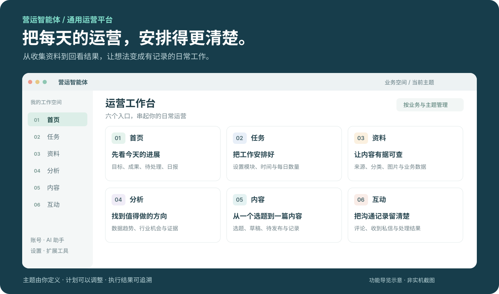
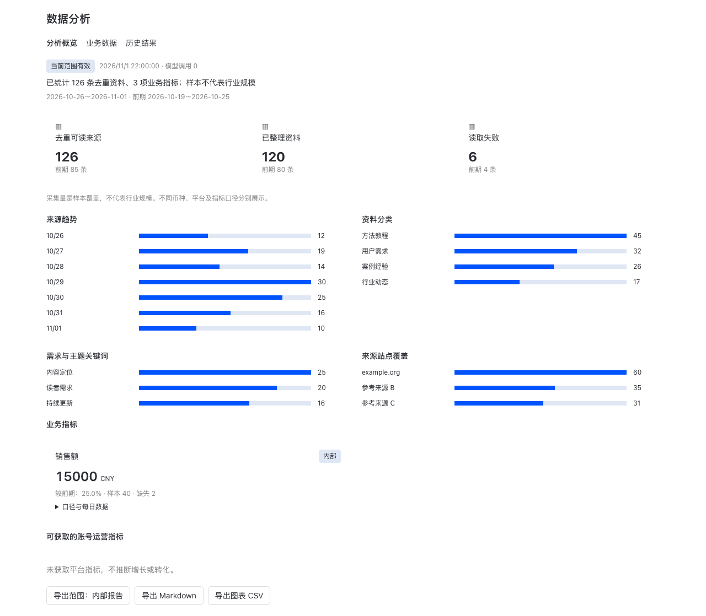
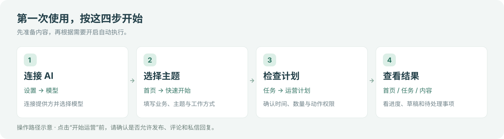

<p align="center">
  
</p>

<h1 align="center">营运智能体</h1>

<p align="center"><strong>把找资料、做内容、安排任务和回看结果，放进同一个工作台。</strong></p>
<p align="center">macOS 桌面应用 · 简体中文 · 支持多业务与多主题</p>

<p align="center">
  <a href="#能帮你做什么">了解功能</a> ·
  <a href="#第一次使用">快速上手</a> ·
  <a href="#日常怎么用">操作指南</a> ·
  <a href="#常见问题">常见问题</a> ·
  <a href="#开发者入口">开发者入口</a> ·
  <a href="#打包并分发-macos-应用">打包分发</a>
</p>



<p align="center"><sub>功能导览示意，非实机截图；用于说明主要入口与用途，实际界面以当前版本为准。</sub></p>

面向个人创作者、门店商家、品牌团队和日常运营者。你来确定业务、主题、受众与目标，营运智能体帮助你收集资料、梳理选题、准备内容，再按你确认的计划执行与复盘。

**可以只用它研究资料、准备草稿，也可以在配置好账号、素材和动作权限后开启自动运营。** 不需要一次用完所有功能。

## 能帮你做什么

| 你想完成的事 | 在哪里操作 | 能得到什么 |
| --- | --- | --- |
| 看清今天做了什么 | **首页** | 当前目标、执行进度、成果、待处理事项和日报 |
| 安排每天的运营工作 | **任务** | 运营计划、执行时间、每日数量、正在运行和历史记录 |
| 收集并整理内容依据 | **资料** | 网页与 RSS 来源、分类资料、授权图片和导入的业务表格 |
| 找到值得关注的方向 | **分析** | 数据趋势、行业分析、结论依据和待核实事项 |
| 从选题走到内容交付 | **内容** | 一键生成完整图文、人工审核、定时发布、发布记录和导出文件 |
| 管理已授权的互动 | **互动** | 评论、收到私信和回关的处理记录与结果 |

侧栏底部还有 **账号、AI 助手、Token 用量、设置和扩展工具**。多个品牌或项目可以建立不同业务空间，每个业务下面再按主题安排独立计划。

### 看数据，也能回到数据的来源

在「分析」中查看采集趋势、资料分类和业务指标；需要进一步了解时，可以打开原始资料或导出报告。业务表格支持 CSV、Excel，你可以分别设置哪些数据允许模型读取、哪些汇总指标允许用于公开内容。



<p align="center"><sub>数据分析组件的开发预览：使用演示数据和测试控件，不代表真实经营成果或完整 App 实机界面。</sub></p>

> 采集样本反映本次收集到的资料，不代表整个行业规模。没有取得的平台指标会显示缺失，不会补成虚构的增长数字。

## 第一次使用

如果你已经拿到 macOS 测试安装包，打开应用后按下面四步配置。当前处于开发预览阶段；需要从源码运行的读者可直接跳到[开发者入口](#开发者入口)。



### 1. 连接一个 AI 模型

进入 **设置 → 模型**，添加提供方、完成登录或填写 API Key，再选择要使用的模型。

支持深度求索、阿里云百炼、月之暗面、智谱等提供方，以及 OpenAI、Claude、Gemini 和本地模型。可以使用自己已有的服务；模型调用是否收费、如何计费，由所选服务决定。

### 2. 告诉它你要做什么

在 **首页 → 快速开始** 选择业务类型，填写具体主题，再选择工作方式。业务类型只是帮助你填写初始设置，主题可以完全自定义。

例如：

> 我经营一家社区咖啡店，希望分享咖啡知识和门店日常。面向附近的上班族，先整理选题并准备草稿，暂时不自动发布。

还没想好方向时，打开 **AI 助手**，说明已有素材和目标，让它先给你几个候选方向。

### 3. 检查计划，再决定是否开始

进入 **任务 → 运营计划**，确认要启用的功能、执行时间和每日数量。

- **先试用内容准备**：选择准备内容的工作方式，确认发布、评论和私信等外部动作未开启。
- **需要自动执行**：到「账号」登录平台，补充有权使用的图片和回复知识，再检查相应动作权限。
- **还没准备好**：新计划可以点击「保存，稍后开始」，之后再继续配置。

**点击「开始运营」会按保存的规则启动首轮工作。日常生成的图文先进入待审核，人工审核并选择发布时间后才会发布。** 已授权的互动仍按计划执行；自动稿默认生成杂志组图，基础文字封面可在任务设置中选择。

### 4. 看进度，查看自己的成果

回到 **首页** 查看进展和待处理事项；在 **任务** 中打开执行详情，在 **内容** 中查看草稿与发布记录。

需要调整时，回到同一份运营计划修改即可。「立即执行」会发起新的运行批次，已完成的模块也可能重新运行；遇到结果不明的发布，先查看核对状态。

## 日常怎么用

### 准备一篇有依据的内容

**生成完整图文 → 人工审核并排期 → 到时发布**

1. 在任务计划中设置关注主题、关键词或指定来源。
2. 到「资料」查看采集正文、出处和整理结果，把有长期价值的资料加入长期素材。
3. 到「内容 → 待审核」点击「生成待审图文」。系统使用已有可用选题；没有选题时先生成，默认生成清爽杂志风格的封面与正文组图，通常 3–6 页，最多两张 AI 主视觉；文字和图表本地排版。需要先配置生图及视觉模型。
   自动检查发现问题时，会根据检查理由修订并复检，最多两轮；原稿与每轮修订版本均保留，两轮后仍不通过则交给人工处理。
4. 在「预览与审核」中核对完整图片、正文与来源，可替换封面或编辑为新版本。选择时间后点击「审核通过并定时发布」，在「已排期」中可改期或取消排期。新版本不会自动继承旧排期；保存时可以明确选择同时取消旧版本排期。

   展开 **「设计封面 · 三个候选与样式编辑」**，可调整封面主标题、副标题、栏目、关键词、版式、配色和字号，查看小图及大图后选用。封面标题可以与文章标题不同；调整样式使用本地绘制和缓存，不另行调用模型。应用封面会保存为新待审核版本，旧稿与原排期不会被悄悄替换。
5. 到时保持应用与账号在线，后台按分钟检查并提交这篇已审核稿件。排期绑定具体版本，改稿需重新审核；平台审核中或结果不明时不会重复提交。

任务调试中勾选「图文发布」，由自动检查代替人工审核并立即真实发布，每批最多一次，不改变日常审核要求。

**配图升级：**自动稿默认使用「杂志组图」。手写稿可在独立写稿页点击「生成杂志组图」，预览后再应用；保存草稿不会触发生图。可以重试失败部分、单独重做主视觉或恢复上一套。基础文字封面仍可在任务设置中显式选择，生成失败不会自动降级。[查看实际样张与使用说明](docs/visual-generation.md)。

手动创作可进入 **「内容 → 写作草稿 → 手动写稿」**，在独立页面中像 Word 一样编辑标题、列表、表格、代码和图片。停止输入两秒自动保存，也支持 **⌘S**；长文和未完成稿可以暂存，断网时显示“仅本机暂存”。点击“提交审核”后才会生成正式版本，再由人工审核、安排发布时间。编辑旧稿会建立工作副本；多窗口冲突可另存副本，不会静默覆盖。详见 [独立写稿使用说明](docs/writing-editor.md)。

参考图片与可发布素材分开管理；杂志组图结合 AI 主视觉与本地文字排版，上传替换图片需要具有使用权。

### 登录账号，查看运营画面

打开侧栏底部的 **账号**，选择平台并点击「检查／登录」，在内嵌网页完成登录或验证，完成后点击 **结束接管**。

点击窗口右上角的 **运营画面**，可以在右侧查看执行页面；收起画面后，后台页面仍会保留。人工接管期间，相应账号的网页动作会暂停，便于你处理登录或页面问题。

### 管理多个业务与主题

使用侧栏顶部的选择器切换业务空间和主题。例如，一个业务用于门店运营，另一个用于个人内容创作；每个业务下面可以建立多个主题。

资料、分析、草稿和执行记录按主题归属。同一业务可以共享授权素材与回复知识，共用账号需要明确关联。**切换页面不会停止其他已启用主题**；需要停止时，使用对应的主题、业务或全部运营暂停控制。

### 看懂执行结果

| 页面上的状态 | 你可以怎么处理 |
| --- | --- |
| 缺少条件 / 跳过 | 查看原因，补充账号、来源、素材或知识后再安排执行 |
| 已暂停 | 根据原因重新登录、验证或恢复网页，再点击「继续未完成步骤」；已完成步骤不会重跑 |
| 草稿已生成 | 打开正文与配图检查；草稿不等于已经发布 |
| 已提交 / 待核对 | 查看平台审核与内容核对进度，必要时使用「立即核对（不重发）」 |
| 已核对成功 | 查看对应链接、内容与执行证据 |
| 失败 / 中断 | 展开步骤、错误和截图，定位原因后决定如何处理 |

日报依据已保存的执行记录生成，默认展示执行摘要、主要阻塞和分阶段 Token 用量。完整分析与原始回执可按需展开、复制或导出；暂停和恢复后的报告分别保存。

## 常见问题

<details>
<summary><strong>不登录内容平台，可以先用吗？</strong></summary>

可以先研究资料、做分析和准备内容。需要模型生成时，先连接可用的模型服务；发布和互动还需要相应账号、素材、知识与权限。

</details>

<details>
<summary><strong>所有平台都能自动发布吗？</strong></summary>

目前自动网页执行重点围绕小红书。账号页覆盖小红书、知乎、B 站、微信公众号后台和抖音，但支持登录不等于支持该平台的完整自动发布流程。更多平台发布、自动视频和完整指标回收仍属后续扩展。

</details>

<details>
<summary><strong>关闭窗口或让 Mac 休眠后，还会继续吗？</strong></summary>

网页任务需要 Mac 保持唤醒，Desktop 和后台服务保持运行。收起运营画面与退出应用不同；真实最小化和全天持续运行仍需进一步验收。不要把关闭应用当作暂停计划，需要暂停时请在应用内操作。

</details>

<details>
<summary><strong>资料都只保存在电脑里吗？</strong></summary>

配置、资料、内容和执行记录主要保存在本地。调用模型、搜索或其他外部服务时，相关输入会发送给你配置的服务。业务表格可以设置仅本地使用，或只允许模型读取汇总及选定的脱敏字段。

</details>

<details>
<summary><strong>怎样控制模型用量？</strong></summary>

在 **任务 → 运营计划 → 常用设置** 中选择按调用次数或 Token 用量设置每日模型预算，新计划默认 **200 次/天**。还可以展开「全部主题共用的模型预算」设置共享上限；两层预算同时生效，保存不会清空当天用量。在「Token 用量」中查看实际消耗。Token 模式达到上限后停止后续调用，最后一次调用可能超出上限；用量未返回或无法确认时会暂停后续调用。开发调试仍不限额。「设置 → 模型 → 节省 Token 模式」可以控制图像和文件解析，但它不是总费用上限；已有上下文、文字和其他模型调用仍可能计费。

</details>

## 当前版本说明

目前支持 **macOS、简体中文**。资料、分析、内容、计划、执行台账和日报已具备实现；小红书已有单篇真实图文发布与核对记录，但多平台兼容、互动流程、异常恢复和全天无人值守仍需完整验收。正式分发还需完成安装包签名、公证与更新验证。

图片中的导览是功能示意，分析页面使用演示数据。更详细的功能边界、额度、恢复规则和验证记录，见[产品与运行参考](docs/operations-reference.md)及[运营插件说明](plugins/operations/README.md)。

---

## 开发者入口

下面面向从源码运行、参与开发或打包应用的读者。已有应用包的普通用户可以直接使用上面的操作指南。

### 本地开发

需要 macOS、Git 和 Xcode Command Line Tools。在仓库根目录运行；两个终端使用相同的数据目录。

**终端一：先停止已有后台服务，再启动。每次启动都按这个顺序执行。**

```bash
export HERMES_HOME="$HOME/hermes-operations-dev"
export HERMES_RUNTIME_DIR="$HERMES_HOME/tools"
source ./activate
./.hermes/bin/hermes gateway stop
./.hermes/bin/hermes gateway run -v
```

**终端二：启动桌面端。**

```bash
export HERMES_HOME="$HOME/hermes-operations-dev"
export HERMES_RUNTIME_DIR="$HERMES_HOME/tools"
source ./activate
npm ci # 首次运行或依赖变化时执行
HERMES_DESKTOP_HERMES_ROOT="$PWD" npm run dev --workspace apps/desktop
```

首次使用独立数据目录，需要重新配置模型提供方；其他配置空间的凭证不会自动继承。环境、连接、调试、Token 解析开关与完整命令见[产品与运行参考](docs/operations-reference.md#本地开发)。

### 验证与构建

```bash
# 仓库阻断性静态检查
python scripts/check

# Desktop 类型与界面测试
npm run typecheck --workspace apps/desktop
npm run test:ui --workspace apps/desktop

# Python 测试统一使用仓库运行器
scripts/run_tests.sh tests/plugins/test_operations_debug.py -q

# 当前桌面构建的外壳测试包，不准备新的 Python 运行时，也不上传
npm run dist:mac --workspace apps/desktop -- --publish never
```

Python 测试需要独立测试环境。完整运行时安装包、签名、公证与发布准备见[构建指南](apps/desktop/BUILDING.md)；详细命令见[发布命令](docs/operations-reference.md#发布命令)。开发阶段不维护旧运营数据库兼容，升级前请核对数据格式说明。

### 打包并分发 macOS 应用

本项目仅提供 macOS 桌面应用。终端聊天前端 `ui-tui`、`hermes --tui` / `--cli` 和“在终端中打开会话”已移除；完整包只装入桌面界面及共享后台。`tui_gateway` 是桌面仍使用的共享后端，管理命令和非交互批处理保留。

发给没有开发环境的用户，请选择 **`bundled` 完整包**：它同时包含 Electron 界面、Python 后台、锁定的依赖及托管工具，用户安装后不必再执行 `npm run dev`。模型服务仍需用户自行配置或登录。发行包不包含源码专属的“任务调试”页面，普通用户通过内容审核和排期操作。

**本机一键入口**

[打包脚本](scripts/package_desktop.py)将本机架构、Python、Xcode、发行仓库和签名身份保存在 `.desktop-packaging/config.json`，并生成 `.desktop-packaging/package.sh`。整个本机目录以及 `.p12`、`.pfx`、`.p8` 文件均已加入 `.gitignore`；共享脚本保留在源码中，密码和私钥不写进配置。

首次在一台 Mac 上配置时，用 Python 3.11+ 执行一次；已配置的机器无需重复初始化：

```bash
python3 scripts/package_desktop.py init
```

以后在仓库根目录使用：

```bash
# 只检查环境、工作区和本机配置，不构建
.desktop-packaging/package.sh check

# 完整测试包：核对并提交源码改动后执行
.desktop-packaging/package.sh build
```

默认选择本机原生架构和 `bundled` 完整包，产物在 `apps/desktop/release/`。脚本不会自动提交、创建标签或上传发行安装包；构建会清理旧构建输出。Python 或 Xcode 路径变化时，更新本机配置及入口脚本。自动更新地址需另行配置，不能把打包成功当作更新服务已经可用。

正式签名需要先把含私钥的 **Developer ID Application** 证书导入登录钥匙串；只有 Apple Development 证书时无法完成分发签名。准备好证书后执行：

```bash
# 选择分发证书，并由Apple工具交互保存公证凭据到钥匙串
.desktop-packaging/package.sh setup-signing

# 先在源码中设置实际发行版本，并创建指向当前HEAD的同版本标签
# v0.1.0仅为示例；check不会创建标签或提交软件
.desktop-packaging/package.sh check --signed --tag v0.1.0
.desktop-packaging/package.sh build --signed --tag v0.1.0
```

签名模式会先核对证书、公证凭据、版本和标签，再调用现有完整构建器；构建后验证 `.app` 的签名、Gatekeeper 和公证票据。缺少凭据时停止，不会降级成未签名包。没有分发证书时，可以先使用普通 `build` 验证完整测试包；安装与更新仍按下文验收。

| 构建方式 | 适用场景 | 是否包含完整本地后台 |
| --- | --- | --- |
| `npm run dist:mac --workspace apps/desktop -- --publish never` | 开发时检查当前界面和打包外壳 | 不会重新准备运行时，不作为完整分发流程 |
| `scripts/build-bundle.sh` | 本机完整安装包测试 | 是，默认 `bundled`；本地脚本不做 Apple 公证 |
| `python3 scripts/bundles/desktop.py --tag vX.Y.Z --variant bundled` | 带签名、公证的版本构建 | 是；需先准备版本、证书和公证凭据 |
| `--variant light` | 连接已有远程后台的轻量客户端 | 否，不适合普通用户在本机运行运营任务 |

**1．准备构建环境与发行信息**

- 在 macOS 构建。当前支持 Apple Silicon 的 `arm64` 和 Intel 的 `x64`；应用配置的最低系统版本为 macOS 13。
- 安装 Git、可用的 **Python 3.11+** 和 Xcode 开发工具。完整构建器会准备锁定版本的 Python、Node、npm 等，不要求另行手工安装这些运行时依赖；签名、公证还需可用的 `codesign`、`notarytool` 和 `stapler`。
- 在对应架构的 Mac 或原生 CI runner 上分别构建、验收。当前完整构建器根据构建环境选择目标，不要直接加 `--x64` 或 `--arm64`，让 Electron 与 Python 运行时混用不同架构。
- 所有命令都在仓库根目录运行。构建打包已提交的 `HEAD`，**工作区必须干净，未提交修改不会作为发行内容**。

先检查工具：

```bash
git --version
python3 --version
xcode-select -p
xcrun --find clang

# 正式签名、公证还需通过下面两项
xcrun --find notarytool
xcrun --find stapler
```

如果系统 `python3` 低于 3.11，先切换到满足要求的 Python；本机测试脚本会尝试选择符合版本要求的 `python3` 或 `python`。

打包前核对以下文件。正式发行需确认版本、品牌与更新地址。完成源码修改后提交：

| 文件或设置 | 要确认的内容 |
| --- | --- |
| [pyproject.toml](pyproject.toml) | 当前版本为 `0.0.0`；发行前改为实际版本，例如 `0.1.0`。稳定标签需与它一致，桌面产物版本由完整构建器注入 |
| [product-identity.cjs](apps/desktop/product-identity.cjs) | 核对 `bundled` 的显示名称、应用标识和安装身份，并确认用户数据目录是否需要与上游版本隔离。当前完整包默认名仍为 **`Hermes Agent`**，修改开发环境的应用名不会自动改掉它 |
| [electron-builder.config.cjs](apps/desktop/electron-builder.config.cjs) | 核对图标、协议、打包资源和更新配置；使用本项目自己的发行身份 |
| `GITHUB_REPOSITORY`、`CLOUDFLARE_R2_PUBLIC_URL` | 使用自己的发行仓库和更新服务，不能把运营版的更新交给上游 Hermes。完整更新管线另见下文 |
| 根目录 [LICENSE](LICENSE) | 已恢复项目原始 MIT 许可证；发行时保留版权声明及第三方许可说明 |

不要把开发 Profile、数据库、API Key、网站登录数据或签名私钥提交进源码。安装后的用户数据保存在应用包外，不能把开发机的数据目录当作运行时载荷复制给用户。

**2．先生成完整的本机测试包**

```bash
# 此命令应无输出；先核对并提交需要打包的改动
git status --short

# 完整构建当前提交，不需要创建标签或推送代码
scripts/build-bundle.sh
```

产物位于 `apps/desktop/release/`，包括当前架构的 **DMG、ZIP 和应用目录**，具体名称以构建输出为准。DMG 供用户下载后安装，ZIP 也是后续更新管线需要的产物。

本地脚本会清理上一次构建输出、复用依赖缓存，并清除用于正式签名公证的环境变量。它生成的是验证完整运行时的测试包，**不是正式公证发行包**；即使系统钥匙串中的证书参与了部分二进制签名，也不能据此视为已完成公证。

**3．准备签名与公证，构建正式版本**

需要自己的 Apple Developer 账号，以及包含私钥的 **Developer ID Application** 证书。将导出的 `.p12` 放在源码仓库外；公证凭据可以使用钥匙串配置，或通过 CI 注入 App Store Connect API Key。Apple 的机制说明见[签名与公证文档](https://developer.apple.com/documentation/security/notarizing-macos-software-before-distribution)。

下面使用“`.p12` 签名证书＋钥匙串公证凭据”。`v0.1.0` 和证书路径均为示例，按实际发行版本替换。凭据初始化命令请逐条执行，完成交互提示后再继续：

```bash
# 交互式保存公证凭据到钥匙串；按提示输入账号、团队及应用专用密码
xcrun notarytool store-credentials "operations-notary"

export CSC_LINK="/absolute/path/DeveloperID.p12"

# 输入证书密码，输入不回显；不要把真实密码写进 README 或提交到仓库
read -r -s CSC_KEY_PASSWORD
export CSC_KEY_PASSWORD

export APPLE_NOTARY_PROFILE="operations-notary"
unset CSC_IDENTITY_AUTO_DISCOVERY
export GITHUB_REPOSITORY="your-org/your-repository"

# 先提交版本和发行配置，确认工作区干净；标签必须指向当前 HEAD
git status --short
git tag v0.1.0

# 直接调用完整构建器；不要用会清除签名凭据的 build-bundle.sh
python3 scripts/bundles/desktop.py --tag v0.1.0 --variant bundled --clean
```

也可以用 `APPLE_API_KEY`（`.p8` 文件路径）、`APPLE_API_KEY_ID`、`APPLE_API_ISSUER` 替代 `APPLE_NOTARY_PROFILE`。现有 CI 使用 Secret `APPLE_API_KEY_P8` 写出密钥文件，再交给公证钩子；CI 中直接注入签名变量，不执行上面的交互式 `read`。不要把密钥内容写入构建命令或项目文件。

完整构建会准备运行时并构建 Electron，签署应用及嵌套二进制，再由 [notarize.mjs](apps/desktop/scripts/notarize.mjs) 提交 Apple 公证并将票据附加到 `.app`。**公证凭据未配置完整时，钩子可能跳过公证；仅出现“打包成功”不代表可以正式分发。** 应核对日志中的 `Accepted` 和票据附加结果。

构建器默认不会上传应用安装包或更新频道。公证会把待公证软件提交给 Apple；向用户分发或上传自己的发布站点是后续步骤。

**4．验证产物，再发给用户**

将下面路径替换成实际生成的 `.app` 路径。若改了产品名称，应用文件名也会变化：

```bash
RELEASE_APP="apps/desktop/release/mac-arm64/你的应用名.app"

codesign --verify --deep --strict --verbose=2 "$RELEASE_APP"
spctl --assess --type execute --verbose=4 "$RELEASE_APP"
xcrun stapler validate "$RELEASE_APP"
```

如果分发流程还需要给 **DMG 本身**附加公证票据，可以在生成最终 DMG 后执行：

```bash
RELEASE_DMG="apps/desktop/release/实际安装包名称.dmg"
xcrun notarytool submit "$RELEASE_DMG" --keychain-profile "$APPLE_NOTARY_PROFILE" --wait
xcrun stapler staple "$RELEASE_DMG"
xcrun stapler validate "$RELEASE_DMG"
```

ZIP 分发的是其中已经签名并附加票据的 `.app`，不要对 ZIP 执行 `stapler`。签名后不要修改包内源码、依赖或资源；改动后应重新构建、签名和验证。

在另一台同架构 Mac 或干净用户环境完成实际验收：

1. 退出开发版，停止旧后台，再安装并启动测试应用，避免旧开发环境掩盖运行时缺失。
2. 双击 DMG，将应用拖入「应用程序」，从 Finder 启动；无需打开终端、Vite 或手工运行 Python 后台。
3. 配置模型，验证聊天、资料读取、生成待审图文和登录状态持久化；发布验收另选明确授权的测试稿件。
4. 退出再打开应用，确认用户数据仍在，且没有连接到开发目录或依赖源码仓库。
5. 分别记录版本、提交 SHA、架构、签名身份及验收结果，再将对应 DMG 分发给用户。

**5．需要自动更新时，再接入发行管线**

自动更新还需要自有更新地址、匹配的 DMG/ZIP、更新清单以及真实的旧版→新版安装测试。只上传一个 DMG 不等于完成自动更新。

- 先核对 [.github/workflows/desktop-bundled-release.yml](.github/workflows/desktop-bundled-release.yml)、[稳定版构建流程](.github/workflows/stable-release.yml)和[稳定版发布流程](.github/workflows/stable-release-publication.yml)中的仓库、存储地址、权限与 Secrets。
- 本项目已有 R2/更新频道管线；使用自己的 `CLOUDFLARE_R2_PUBLIC_URL`、存储桶和相关凭据，并按该流程发布产物与更新清单。仅设置 `GITHUB_REPOSITORY` 不代表 macOS 更新链路已经配置完成。
- 原生更新验收使用实际签名包，验证旧版安装、应用内更新、自动重新启动和用户数据保留，参见[安装与更新验收](tests/install/BUNDLED_UPDATES.md)。
- `--commit` 构建适合独立试用，自动发行频道更新被关闭，应用身份带提交后缀；不要把它当成稳定版本的长期升级路线。

当前 README 描述的是构建与验收方法，不表示本运营分支已经产出通过全部分发验收的正式安装包。更细的准备/构建分离、缓存和版本规则见 [Desktop 构建指南](apps/desktop/BUILDING.md)。

### 文档导航

| 文档 | 适合什么时候看 |
| --- | --- |
| [产品与运行参考](docs/operations-reference.md) | 查功能细节、额度、执行边界、调试与完整启动命令 |
| [运营插件说明](plugins/operations/README.md) | 查运营规则、数据保存、接口和恢复方式 |
| [功能代码导航](docs/code-map.md) | 按功能定位实现与测试 |
| [开发工作流](docs/development-workflow.md) · [当前交接](docs/dev-handoff.md) | 继续已有任务、核对改动与验证范围 |
| [Desktop 文档](apps/desktop/README.md) · [构建指南](apps/desktop/BUILDING.md) | 桌面连接、排错、打包与更新 |
| [开发约束](AGENTS.md) · [贡献指南](CONTRIBUTING.md) · [测试指南](tests/AGENTS.md) | 开始修改代码前查阅 |

### 项目来源与许可证

基于 Nous Research 的 Hermes Agent，遵循 [MIT 许可证](LICENSE)，元数据见 [pyproject.toml](pyproject.toml)。独立技能与第三方依赖遵循各自的许可证。
