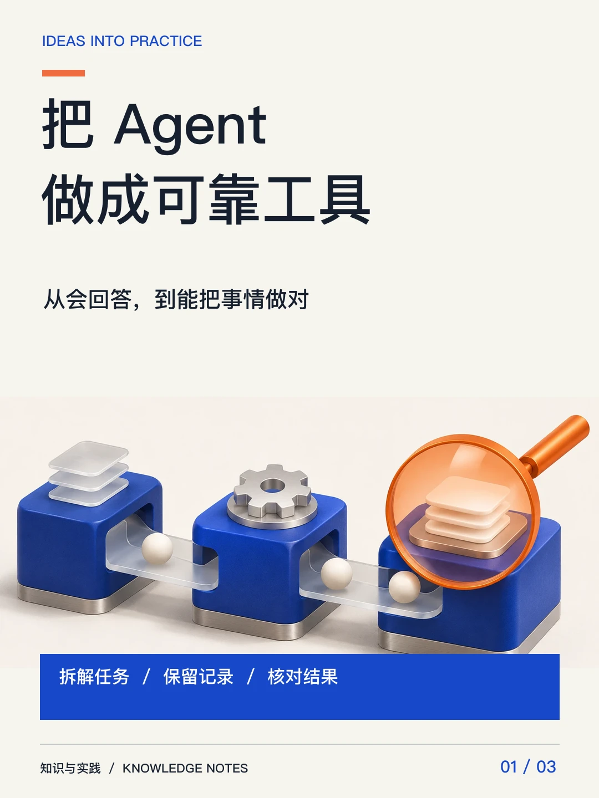
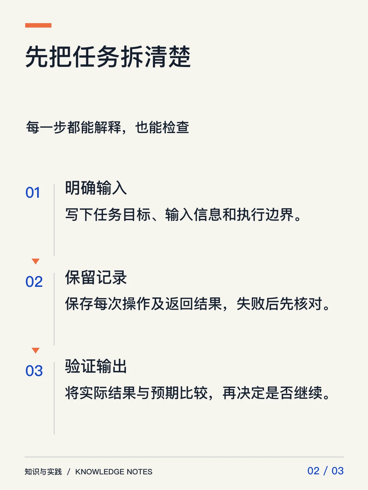
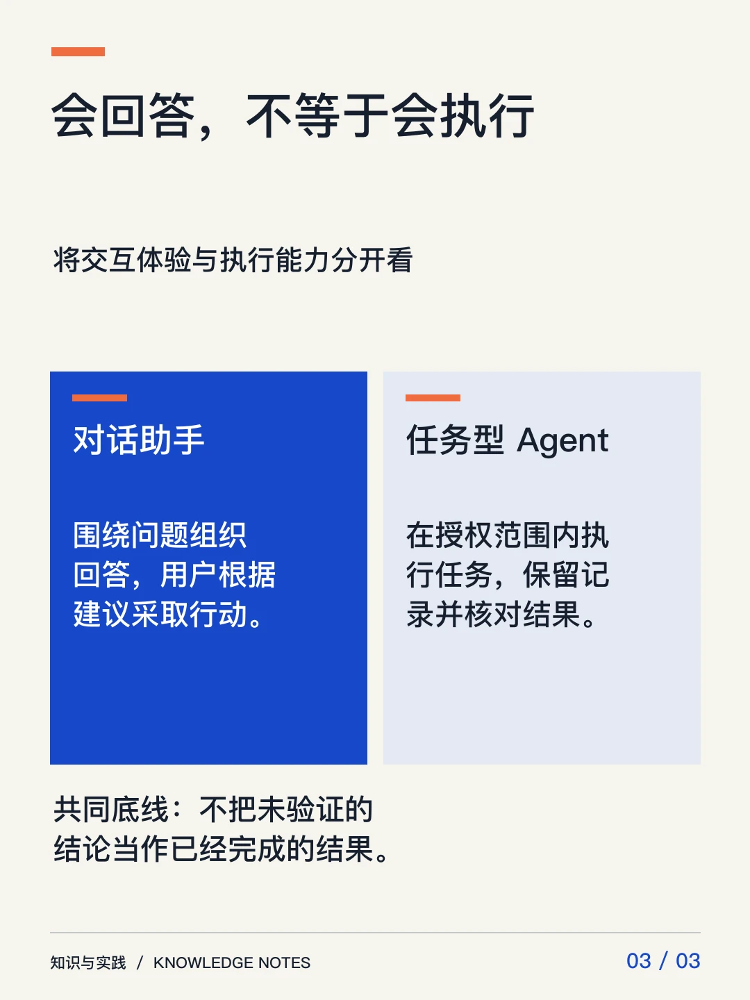

# 杂志组图：AI 主视觉与精确中文排版

默认采用「清爽杂志与信息图」风格，通常 3–6 页。内容少时可以少于三页，不编造信息凑页。每篇最多生成两张 AI 主视觉，并共用一次额外尝试；文字、流程和对比内容由本地程序绘制。插画是概念示意，不代表真实截图或实测结果。

## 看实际样张

以下为演示稿，主视觉使用内置 imagegen 生成，文字与页面由项目中的 `visual_render.py` 合成；没有发布到平台。效果不是生图模型直接画中文。

| 封面 | 流程内页 | 对比内页 |
|---|---|---|
|  |  |  |

[完整主视觉](assets/visual-samples/agent-workflow-art.webp) · [页面文案](assets/visual-samples/storyboard.json)

## 使用

- 在「扩展工具」的工具能力中配置**生图模型**及**视觉分析模型**；模型与费用由已选择的提供方决定，系统不默默换供应商。
- 「生成待审图文」及日常内容生产默认配齐组图。任务设置的「自动配图方式」可显式切回基础文字封面；它只做本地排版，不产生生图费用。
- 手写稿打开「生成杂志组图」，保存当前稿件后点击「生成整套图文」。自动保存本身不生成图片、不调用模型。
- 整组预览后点击「应用整套组图（替换当前配图）」。手写稿只更新工作副本，正文与表格保留；正式稿另建待审版本，不迁移旧排期。
- 可以取消、重试未完成部分，或明确消耗一次生图重做某页主视觉。重做失败可恢复上一套；费用记录和尝试次数不会重置。
- 未配置模型、超时、额度不足或视觉检查不可用时显示具体原因并保留草稿。不会把基础封面当作成功的杂志组图。机器视觉检查不代表人工审核；人工确认和已有发布授权流程仍然生效。

## 成本、缓存与恢复

分页设计与视觉检查纳入原模型额度，调试仍遵循现有额度豁免。生图单独展示调用尝试、可用 Token 回执和费用信息；按张计费或未返回回执的提供方显示未知，不按零计算。图像生成的三次尝试上限在重试、服务重启和自动修订之间保留。

分页结果、AI 主视觉、已完成页面分别持久化。同一输入重开或重复点击不重做；改动文字而主视觉提示及模型配置不变时可复用原插画。撤回素材不会被缓存重新授权。旧异步结果不得继续应用到新执行代次、已取消任务或改动后的稿件。

单次生图外层等待上限为 360 秒；超时不意味着提供方已停止或不会计费。重试由用户明确触发并计入额外尝试。后台重启后旧任务显示中断，保留成果，等待手动重试。

## 实现与验收

- `visual_plan`：受限分页数据，完整可见文案进入事实检查；单页最多三个要点，总文案不超过 160 字，先校验排版再发起付费生图。
- `visual_provider`：复用已有生图供应商与 Profile 配置，不增加核心工具。图片保存在当前 Profile 生成缓存及现有授权素材库。
- `visual_jobs` / `visual_sets`：独立后台线程、执行代次、幂等请求、取消、恢复、单页重做和整套应用；不新增常驻后台进程。
- `visual_review`：使用已有辅助视觉模型检查实际合成图；组合变化后不能复用旧组合的通过记录。
- 私有 `/visual-sets` 接口提供创建、状态、取消、恢复及应用，沿用连接、Profile、业务和主题权限。应用使用现有草稿修订号或正式稿指纹。
- 验收包括 Python 回归、Desktop 交互、真实 macOS Electron 的组图应用和长文保留、类型检查及仓库检查。没有使用真实发布验收。

## 验收主视觉提示词

本次样张使用 **内置 imagegen**，原始图片压缩为 WebP 后保存在本目录。运行时提示词根据每篇文章生成，不会固定复用这张演示图。

```text
Use case: stylized-concept. Asset type: landscape editorial illustration to be composed under separately rendered Chinese typography in a high-quality Xiaohongshu knowledge carousel.
Primary request: visually explain an AI agent as a reliable, inspectable workflow rather than a magic chatbot.
Scene: an elegant sculptural system of three connected cobalt-blue modular blocks, translucent glass pathways, and a single vivid warm-orange inspection lens hovering over the final block. A few small ivory spheres moving through the system express tasks flowing through checkpoints.
Materials: matte ceramic, brushed anodized metal and frosted glass, subtle paper-grain backdrop.
Style: premium contemporary design magazine, refined physically plausible 3D still life, calm sophistication, precise visual hierarchy, no playful toy clutter.
Composition: wide landscape 3:2, central sculptural subject occupying 70 percent, generous clean cream margins, all important objects inside the central 80 percent so a wide crop remains intact.
Lighting: large soft studio daylight, delicate contact shadows, crisp details.
Palette: ivory #F7F5EF, cobalt #1748CA, orange #EF6B3F, charcoal accents.
Text: none. No text, letters, numbers, logos, watermarks, interfaces, charts, arrows with text, screenshots, fake real-world evidence or busy decorative background. Opaque background.
```
